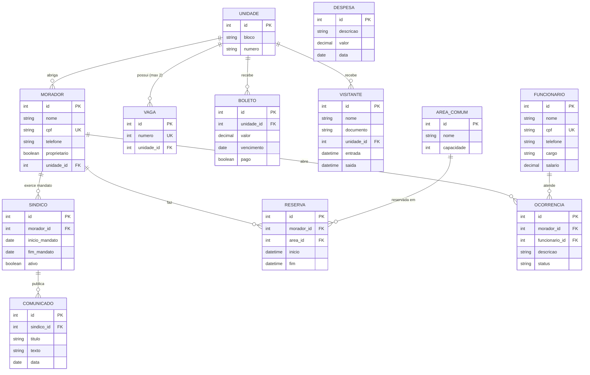

# 04 — Modelo de dados

Entidades já implementadas: `Unidade`, `Morador`, `Sindico`, `Funcionario`, `Vaga`.
Entidades propostas para módulos futuros: `Visitante`, `AreaComum`, `Reserva`, `Boleto`, `Despesa`, `Ocorrencia`, `Comunicado`.

`Morador` e `Funcionario` herdam de `Pessoa` (`@MappedSuperclass`: id, nome, cpf, telefone).

