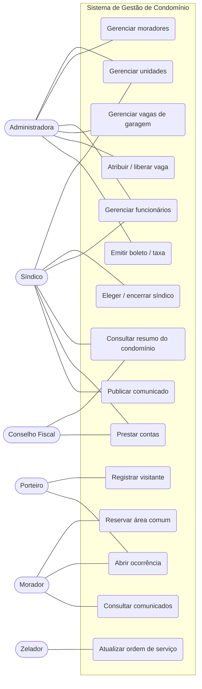
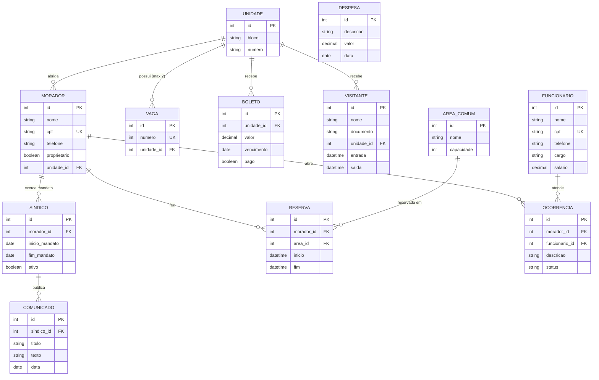

# Gestão de Condomínio — Evidências da Entrega

Disciplina: Programação Orientada a Objetos (GPE17N40158)

## 00 — Repositório compartilhado
Projeto em grupo. Link do repositório / pasta compartilhada (Git, OneDrive ou Google Drive): **<preencher>**
Integrantes com acesso: **<preencher>**

---

## 01 — Módulos do sistema (12 módulos)

| # | Módulo | Descrição | Situação |
|---|--------|-----------|----------|
| 1 | Unidades | Cadastro de blocos e apartamentos | Implementado |
| 2 | Moradores | Proprietários e inquilinos, vinculados a uma unidade | Implementado |
| 3 | Síndico | Eleição, mandato e histórico de síndicos | Implementado |
| 4 | Funcionários | Cadastro por cargo, salário e folha | Implementado |
| 5 | Garagem | Vagas e atribuição/liberação por unidade | Implementado |
| 6 | Resumo / Relatórios | Visão geral do condomínio (totais, vagas, folha) | Implementado |
| 7 | Visitantes e Portaria | Registro de entrada/saída de visitantes e prestadores | Proposto |
| 8 | Áreas Comuns e Reservas | Salão de festas, churrasqueira, quadra; agendamento | Proposto |
| 9 | Financeiro | Taxa de condomínio, boletos, inadimplência | Proposto |
| 10 | Despesas e Prestação de Contas | Contas a pagar, fornecedores, balancete | Proposto |
| 11 | Ocorrências e Manutenção | Chamados, reclamações, ordens de serviço | Proposto |
| 12 | Comunicados e Assembleias | Avisos, atas, pautas e votações | Proposto |

## 02 — Personas (perfis de acesso)

| Persona | Perfil de acesso | O que faz no sistema |
|---------|------------------|----------------------|
| **Síndico** | Administrador | Gerencia unidades, moradores, funcionários, finanças, comunicados e assembleias; vê o resumo do condomínio |
| **Administradora / Secretaria** | Administrativo | Cadastra moradores, vagas e funcionários; emite boletos e relatórios |
| **Morador (proprietário/inquilino)** | Usuário comum | Consulta dados da própria unidade e vagas, reserva áreas comuns, abre ocorrências, vê comunicados e boletos |
| **Porteiro** | Operacional | Registra visitantes, entregas e ocorrências de portaria |
| **Zelador / Manutenção** | Operacional | Consulta e atualiza ordens de serviço e ocorrências |
| **Conselho Fiscal** | Consulta | Visualiza prestação de contas e relatórios financeiros |

## 03 — Diagrama de Casos de Uso (Mermaid)

## 04 — Modelo de dados (Mermaid)

Entidades já implementadas (`Unidade`, `Morador`, `Sindico`, `Funcionario`, `Vaga`) e entidades propostas para os módulos futuros (`Visitante`, `AreaComum`, `Reserva`, `Boleto`, `Despesa`, `Ocorrencia`, `Comunicado`).

`Morador` e `Funcionario` herdam de `Pessoa` (`@MappedSuperclass`: id, nome, cpf, telefone).

---

## 04 — Análise do projeto `loja-jpa-cl` (dúvidas a anotar)

> Este item exige executar o projeto no IntelliJ e anotar as dúvidas. **Preencher após a execução.**

Pontos para observar (a estrutura é a mesma usada no nosso projeto):
- `persistence.xml`: unidade de persistência, driver, URL e `hbm2ddl.auto`.
- `JPAUtil`: criação do `EntityManagerFactory` e de `EntityManager`.
- Camadas `model` → `repository` → `service` → `view`: quem chama quem?
- Anotações JPA: `@Entity`, `@Id`, `@GeneratedValue`, `@ManyToOne`, `@JoinColumn`.

Dúvidas: **<preencher>**

## 05 — Collections
Arquivo único: `docs/Colecoes.java` (ArrayList, HashSet e HashMap aplicados ao domínio do condomínio).
Para rodar: `javac Colecoes.java && java Colecoes`
